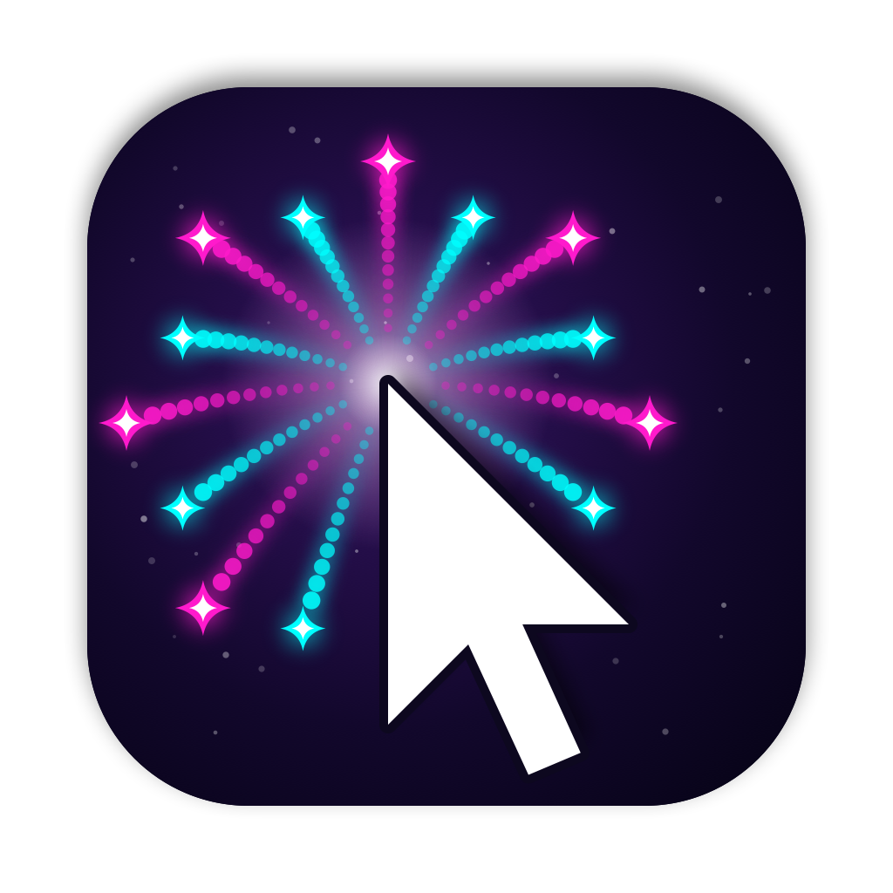

<p align="center"></p>

# Clickle ✨

Fireworks, sparkles and neon ripples on every mouse click — a tiny macOS menu-bar app.

Clickle draws a click effect wherever you click, in any app, on every display, even over the menu bar and full-screen apps. Clicks still go straight through to whatever is underneath.

## Effects

| Effect | What it looks like |
|---|---|
| **Firework** (default) | A round burst of glowing sparks with trails that droop and twinkle out |
| **Firework – willow** | Slow, heavy sparks with long trails that fall like willow branches |
| **Firework – double ring** | Two crisp rings of sparks, one inside the other |
| **Sparkles** | Four-pointed stars, dots or hearts that burst and fall |
| **Circle pop** | A filled circle that grows and fades |
| **Ripple rings** | Three rings rippling outward |
| **Light rays** | Coloured lines shooting out in a circle |
| **Dash burst** | Two staggered rings of short dashes flying outward |
| **Surprise me** | A random effect on every click |

Color themes: **Ice** (default), Neon, Magic, Gold, Rainbow, Pink, or any custom color.

## Requirements

- macOS 14 (Sonoma) or later
- Apple's Command Line Tools (for the Swift compiler). Full Xcode is **not** needed.

Check whether you already have them:

```sh
swiftc --version
```

If that prints an error, install them (a system dialog will appear):

```sh
xcode-select --install
```

## Install

```sh
# 1. Get the code
git clone https://github.com/AbhishekAglave/clickle.git
cd clickle

# 2. Build Clickle.app
./build-app.sh

# 3. Move it into Applications and start it
mv Clickle.app /Applications/
open /Applications/Clickle.app
```

A small cursor-and-firework icon appears in the menu bar. There's no Dock icon — Clickle lives only in the menu bar.

No permissions are needed: Clickle only watches mouse clicks, which macOS allows without Accessibility access.

## Using it

Click the Clickle icon in the menu bar:

- **Clickle On** — turn effects on or off
- **Settings…** (⌘,) — pick the effect and colors, and tune it
- **Quit Clickle**

## Customization (Settings window)

Every change saves automatically and applies to your next click. Use **Preview ✨** to try your settings without leaving the window, and **Reset to Defaults** to go back to the values below.

### General

| Setting | Default | What it does |
|---|---|---|
| Effects enabled | On | Master on/off switch (same as **Clickle On** in the menu) |
| Launch at login | Off | Starts Clickle when you log in. Put the app in `/Applications` first |

### Look

| Setting | Default | Options |
|---|---|---|
| Click effect | Firework | Any effect from the [table above](#effects) |
| Colors | Ice | Ice, Neon, Magic, Gold, Rainbow, Pink, Custom |
| Custom color | `#FFD45A` | Any color, via the color picker (shown when Colors is Custom) |
| Sparkle shape | Stars + dots | Stars + dots, Stars, Dots, Hearts (shown for Sparkles and Surprise me) |
| Neon glow | On | Adds a glowing edge to Circle pop, Ripple rings, Light rays and Dash burst |

Color themes:

| Theme | Colors |
|---|---|
| Neon | Hot pink, cyan, lime, yellow, electric purple, orange |
| Magic | Gold, warm white, pink, sky blue, lavender |
| Gold | Shades of gold and warm white |
| Rainbow | Red, orange, yellow, green, blue, purple |
| Pink | Pinks and blush white |
| Ice | Light blues and white |
| Custom | Your color plus a lighter tint of it |

### Motion

| Setting | Default | Range | What it does |
|---|---|---|---|
| Amount | 24 | 10 – 150 | Number of sparks, sparkles, rays or dashes per click |
| Size | 0.5× | 0.4× – 2.5× | Overall size of the effect |
| Speed | 0.5× | 0.3× – 2.5× | How fast sparks fly out (and how fast shape effects play) |
| Gravity | 1.0× | −1× – 3× | How strongly sparks fall. 0 = no fall, below 0 = float upward |
| Duration | 0.5s | 0.3s – 2.5s | How long each effect lasts |

### Trail

| Setting | Default | Options |
|---|---|---|
| Trail | On drag | None, On drag, Always |

*On drag* draws a trail while you drag with any mouse button; *Always* follows the cursor even when no button is pressed.

The trail always matches your click effect and uses the same colors, size, speed, gravity, duration and Neon glow:

| Click effect | Trail |
|---|---|
| Sparkles | Small sparkles in the same shape and colors |
| Firework, Firework – willow, Firework – double ring | Mini sparks of that same firework |
| Circle pop | No trail |
| Ripple rings | No trail |
| Light rays | One glowing line that tapers from the cursor and fades |
| Dash burst | One line of dashes, the same length as the click's, alternating colors and fading behind the cursor |
| Surprise me | Matches whichever effect played on the last click |

If an effect has no trail (Circle pop, Ripple rings), the Trail option is greyed out and shows *None*.

### Triggers

| Setting | Default | What it does |
|---|---|---|
| Sparkle on right-click | On | Plays the effect on right- and middle-clicks too, not just left-clicks |

## Customizing the code

Everything lives in [`main.swift`](main.swift). After any change, rebuild and restart:

```sh
./build-app.sh
# quit Clickle from the menu-bar icon, then:
open Clickle.app
```

### Change the default settings

Defaults are written in two places — keep them in sync:

1. `defaultSettings` near the top of `main.swift` — what the app uses on first launch and after **Reset to Defaults**.
2. The `@AppStorage(...)` lines in `SettingsView` — what the settings window starts from.

For example, to make Light rays the default effect, change `Effect.firework` to `Effect.rays` in both places.

Settings you've already changed are stored on your Mac and take priority. To start fresh after changing defaults, run `defaults delete com.local.clickle` with Clickle quit.

### Add or edit a color theme

1. Add a case to `enum Theme` (e.g. `case sunset`) and a label for it (`case .sunset: "Sunset"`).
2. Add its colors in `colors(for:)`, using red/green/blue values from 0 to 1:

   ```swift
   case .sunset: return [rgb(1, 0.45, 0.2), rgb(1, 0.25, 0.45), rgb(0.55, 0.2, 0.6)]
   ```

It then appears in the Colors menu automatically.

### Change the slider ranges

Each slider is one line in `SettingsView`, e.g.:

```swift
slider("Amount", $count, 10...150, "%.0f")
```

Change `10...150` to widen or narrow the range.

### Other easy tweaks

| What | Where in `main.swift` |
|---|---|
| Menu-bar icon | `makeMenuBarIcon()` — draws the cursor and mini firework; or replace it with text: `statusItem.button?.title = "✨"` |
| Trails | `Effect.trailStyle` maps each effect to its trail; `SmoothTrail` draws the line trails every frame, `trailPiece` drops the particle ones |
| Firework spark speed, trail length, droop | The `spark(...)` calls in `makeFirework` (`velocity`, `ghosts`, `accel`) |
| Shape-effect sizes | The radii (e.g. `28 * size`, `36 * size`) in `makeShapeEffect` |

### Change the app icon

The icon is drawn in code by [`icon/make-icon.swift`](icon/make-icon.swift): the background, the firework rays, the sparkle stars and the cursor are each a short, commented section. After editing it, regenerate the icon and rebuild:

```sh
./icon/build-icon.sh   # writes icon/AppIcon.icns and icon/icon-1024.png
./build-app.sh
```

To use your own image instead, put a 1024×1024 PNG at `icon/icon-1024.png`, delete the `swift make-icon.swift` line from `icon/build-icon.sh`, and run the two commands above.

If Finder or the Dock still shows the old icon, run `touch /Applications/Clickle.app` or log out and back in. macOS caches icons.

### How the build works

`build-app.sh`:

1. Compiles `main.swift` with `swiftc` into `Clickle.app/Contents/MacOS/Clickle`, and copies `icon/AppIcon.icns` into `Clickle.app/Contents/Resources/`.
2. Writes `Clickle.app/Contents/Info.plist` — the app's name, ID (`com.local.clickle`), minimum macOS version, and `LSUIElement`, which hides the Dock icon.
3. Signs the app with a local (ad-hoc) signature so macOS will run it and allow Launch at login.

`Clickle.app` is a folder that Finder shows as an app; right-click → **Show Package Contents** to look inside.

## Updating

```sh
cd clickle
git pull
./build-app.sh
```

Then quit Clickle from the menu-bar icon and replace the old copy:

```sh
rm -rf /Applications/Clickle.app
mv Clickle.app /Applications/
open /Applications/Clickle.app
```

## Uninstall

1. Quit Clickle from the menu-bar icon.
2. Delete the app: `rm -rf /Applications/Clickle.app`
3. Remove its saved settings: `defaults delete com.local.clickle`
4. If you turned on Launch at login, also check System Settings → General → Login Items & Extensions.

## Troubleshooting

- **`xcrun: error: invalid active developer path`** — the Command Line Tools aren't installed. Run `xcode-select --install`.
- **No Clickle icon in the menu bar** — on a crowded menu bar it can be hidden behind the notch. Quit a few other menu-bar apps, or check that Clickle is running in Activity Monitor.
- **Launch at login doesn't stick** — move `Clickle.app` into `/Applications` first, then toggle it again.

## Contributing

Contributions are welcome. New effects, color themes, fixes and ideas are all fair game.

1. **Fork** this repo on GitHub and clone your fork:

   ```sh
   git clone https://github.com/<your-username>/clickle.git
   cd clickle
   ```

2. **Create a branch** for your change:

   ```sh
   git checkout -b my-new-effect
   ```

3. **Make your change and try it out.** Quit any running Clickle first, then:

   ```sh
   ./build-app.sh && open Clickle.app
   ```

   Use **Preview ✨** in Settings to check your change, and try it on both light and dark wallpapers.

4. **Commit, push and open a pull request** against `main`. Say what you changed, and add a screen recording or GIF if it's visual.

A few guidelines:

- Keep it simple. The whole app is one file, `main.swift`, built with plain `swiftc` (no Xcode project, no dependencies). Please keep it that way.
- Match the style of the surrounding code.
- If you add or change a setting, update the tables in this README too.

Ideas to get started:

- A new effect, such as confetti, hearts or a lightning bolt
- A new color theme
- Click sounds (with an on/off setting)
- Different effects for left and right clicks

Found a bug or have an idea but no time to build it? [Open an issue](https://github.com/AbhishekAglave/clickle/issues).

## License

[MIT](LICENSE). Use it, change it, share it.
